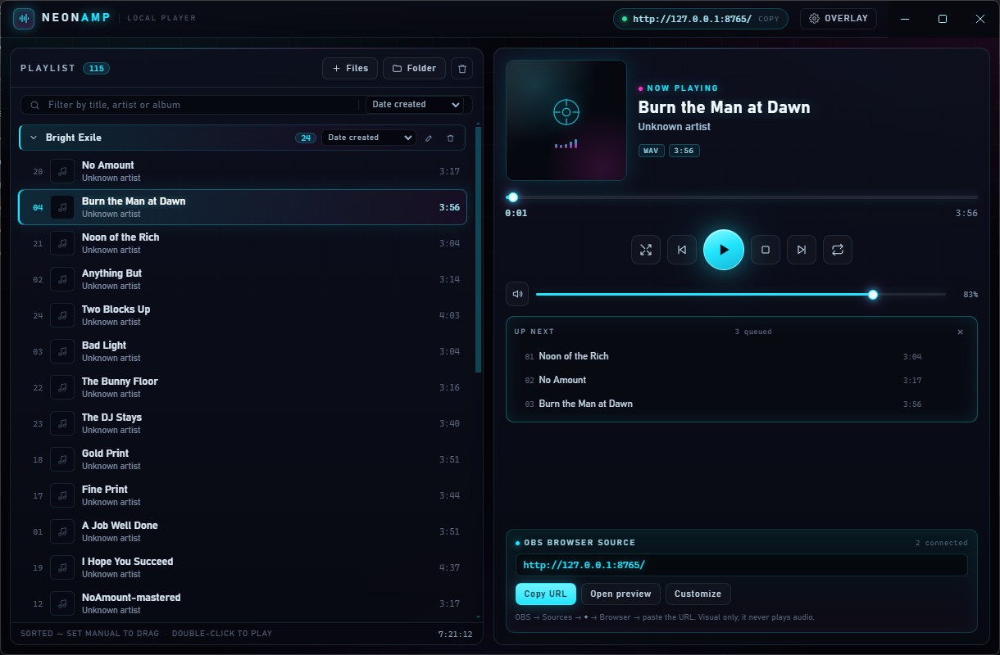
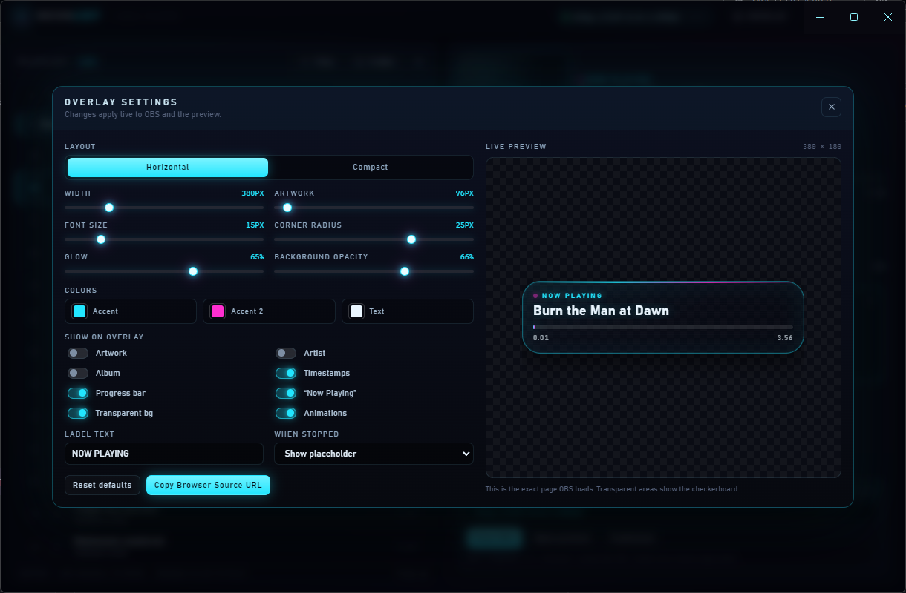

# NeonAmp

A compact, neon-cyberpunk desktop music player for **local MP3 / WAV files**, with a
**Now Playing overlay** you drop into OBS as a Browser Source.

- Real Electron desktop app (Windows first, macOS/Linux capable)
- Playback happens in the app; the overlay is **visual only** and never plays audio
- Local server bound to `127.0.0.1` only — nothing is uploaded, no account needed
- Playlist, volume, preferences and overlay styling persist between sessions

> **AI disclosure:** NeonAmp was built with heavy AI assistance. Most of the code
> and docs were written with **Smaug Flash (Thinking)** through
> [Abacus.AI](https://abacus.ai), working from the author's direction, testing and
> bug reports. It is not hand-written from scratch — read the code before relying
> on it. See [`AI_DISCLOSURE.md`](AI_DISCLOSURE.md).

---

## Screenshots



*The player: album-grouped playlist on the left, Now Playing and the editable Up Next queue on the right, and the OBS Browser Source URL at the bottom.*



*Overlay settings: layout, sizing, colours and visibility toggles on the left, and the exact page OBS loads on the right.*

---

## 1. Install

Requirements: **Node.js 20+** (or 22+), npm.

**Prebuilt Windows binaries** are attached to the
[latest release](https://github.com/Marusame00/NeonAmp/releases/latest):

- `NeonAmp-1.1.0-Setup.exe` — installer, adds a Start Menu entry and desktop shortcut
- `NeonAmp-1.1.0-Portable.exe` — single file, no installation

Neither is code-signed, so Windows SmartScreen will warn on first run
(**More info → Run anyway**).

**From source — no terminal:** double-click **`Start NeonAmp.bat`**. It checks for
Node.js, installs dependencies if `node_modules` is missing, and launches the app.
After the first successful run you can double-click **`NeonAmp.vbs`** for a silent
launch with no console window.

Manual path:

```bash
git clone https://github.com/Marusame00/NeonAmp.git
cd NeonAmp
npm install
```

If `npm install` finishes but `npm start` says Electron is missing, the Electron
binary download was skipped. Run it explicitly:

```bash
node node_modules/electron/install.js
```

## 2. Run

Double-click **`Start NeonAmp.bat`** (shows a console with any errors) or
**`NeonAmp.vbs`** (silent), or from a terminal:

```bash
npm start
```

The window opens and the overlay server starts on **http://127.0.0.1:8765/**.
If that port is taken, the app walks up (8766, 8767, ...) and shows the real URL in
the title bar and in the OBS card at the bottom right.

## 3. Add music

- **Files** — pick one or more `.mp3` / `.wav` files (also `.flac`, `.ogg`, `.m4a`, `.aac`).
- **Folder** — recursively scans a folder and adds it as a named **album** group.
- **Drag & drop** files or folders from Explorer straight onto the window.

Titles, artists, albums, durations and embedded cover art are read from the files.
Missing tags fall back to the filename; missing artwork falls back to a neon glyph.

### Albums and sorting

Adding a folder creates an album group named after the folder. Double-click the
group name (or use the pencil button) to rename it — useful when the folder name
is not what you want on screen. The chevron collapses the group, and the trash
button removes the album and its tracks.

Each album has its own sort order, and the dropdown in the search bar sets the
default for loose tracks and newly added albums:

| Sort | Order |
| --- | --- |
| Manual (drag) | the order you dragged rows into |
| Date created | file creation time, oldest first (falls back to modified time) |
| Title A–Z | natural, so `2` sorts before `10` |
| Filename A–Z | natural, so `01-song` / `02-song` track lists stay in order |
| Artist | artist, then album, then title |
| Album / track no. | album, then embedded track number |
| Duration | shortest first |

Dragging is only enabled while a group is on **Manual**; sorted groups show
`sorted — set Manual to drag` in the footer.

## 4. Play

| Action | Control |
| --- | --- |
| Play / pause | big centre button, or `Space` |
| Stop | ■ button, or `Esc` |
| Previous / next | transport buttons, or `Ctrl+←` / `Ctrl+→` |
| Seek | click/drag the progress bar, or `←` / `→` (±5 s) |
| Volume | slider, or `M` to mute |
| Shuffle | ⇄ button, or `S` |
| Repeat off → all → one | ↻ button, or `R` |
| Reorder | drag rows up/down in the playlist |
| Filter | the search box above the playlist |

Double-click a row to play it. Single click selects it without starting playback.

### Voice ducking

NeonAmp can lower the music by itself while you talk into your microphone, so your
voice stays on top of the track.

- Click the **microphone button** next to the volume slider to turn it on (one click).
- Click the **chevron** beside it to open the ducking panel, then **Calibrate** and
  talk normally for 4 seconds. That sets the sensitivity to your room and your voice.
- **Music while talking** is how low the music goes, as a percentage of your current
  volume — `35%` means it drops to about a third.
- The music fades down quickly when you start speaking (about a quarter second) and,
  after a short pause, eases back up over roughly two seconds once you stop.
- **Microphone** picks the input device; "System default" follows Windows.
- Use headphones. If the music plays through speakers and your mic picks it up, the
  music itself can trigger ducking — raise **Sensitivity trigger** until it stops.

It listens to your microphone locally only — nothing is recorded, saved or sent
anywhere. Windows must allow it first: **Settings → Privacy → Microphone → Let
desktop apps access your microphone**.

For finer control (curves, sidechain, per-source ducking) use OBS's own compressor
filter on your mic and music sources instead.

## 5. OBS Browser Source

1. In OBS: **Sources → + → Browser**.
2. Paste the URL from the app (the `COPY` pill in the title bar, or **Copy URL** in
   the OBS card). Default: `http://127.0.0.1:8765/`
3. Set **Width** to the overlay width (default `470`) and **Height** to about `180`
   for the horizontal layout, `300` for compact.
4. Tick **Shutdown source when not visible** off if you want it to keep its state,
   and leave **Refresh browser when scene becomes active** off — the overlay keeps
   itself in sync over Server-Sent Events and reconnects on its own.

The overlay follows play, pause, seek, skip, stop and track changes within a few
milliseconds, and reconnects automatically if you restart the desktop app.

### Capturing the audio

OBS cannot hear the app by itself. Pick one:

- **Desktop audio** (simplest): OBS **Settings → Audio → Desktop Audio** → your
  default output device. Everything on the machine is captured.
- **Application audio capture** (Windows 10 2004+): add a **Application Audio
  Output Capture** source and select `NeonAmp.exe`. Only the player is captured.
- **Per-app routing**: send NeonAmp to a virtual cable (VB-Cable / VoiceMeeter)
  and add that cable as an Audio Input Capture source.

Do **not** enable "Control audio via OBS" on the Browser Source — the overlay has no
audio, and the player is the only thing that should make sound.

## 6. Customize the overlay

**Overlay** button (title bar) or **Customize** in the OBS card opens the settings
screen with a live preview of the exact page OBS loads.

- Layout: **horizontal** (artwork left, text right) or **compact** (stacked, centred)
- Width, artwork size, font size, corner radius, glow strength, background opacity
- Accent, second accent and text colours
- Transparent background (for OBS), animations on/off
- Show/hide artwork, artist, album, timestamps, progress bar, “Now Playing” label
- Custom label text
- What to show when stopped: placeholder, keep last track, or hide the overlay
- Copy the Browser Source URL, reset to defaults

Everything is saved to `state.json` in the app's user-data folder
(`%APPDATA%\NeonAmp` on Windows) and re-applied on launch.

## 7. Verification (optional)

`npm run selftest` launches the app against generated test media in `smoke/media`
and asserts, end to end: playlist rendering, tag + embedded-artwork extraction,
playback reaching the server, overlay receiving the track, elapsed clock, the
overlay card staying dark (a regression guard for the glow scale), overlay text,
pause freezing position, seek, next-track, stop, state persistence, the
editable queue (add, reorder, play-next, clear), and voice ducking (toggle, mic
level, ducking while speaking, the fade envelope, restore on off, persistence).
It runs 28 checks, exits non-zero on failure and writes screenshots to `smoke/`.

Generate the test media once with ffmpeg (any 12 s MP3 with cover art plus an
untagged WAV named `01-neon-skyline.mp3` / `Untagged Track.wav` in `smoke/media`).

The overlay has also been checked in OBS itself (Browser Source, Windows): the
in-app live preview matches what OBS renders.

## 8. Packaging (optional)

`electron-builder` is intentionally **not** a dependency — it pulls a large tree
(249 packages, ~370 MB of `node_modules`). Install it only when you want to build:

```bash
npm install --no-save electron-builder
npm run dist        # dist/NeonAmp-<version>-Setup.exe + -Portable.exe
npm run dist:dir    # unpacked folder, fastest
```

Artifact names are set per target in `package.json` (`nsis.artifactName` and
`portable.artifactName`) so the installer and the portable build do not collide.

## Architecture

```
main.js                 Electron main process: windows, IPC, dialogs, server lifecycle
preload.js              contextBridge API (contextIsolation on, sandbox on)
Start NeonAmp.bat      double-click launcher: checks Node, installs deps, runs the app
NeonAmp.vbs            silent launcher (no console window)
src/store.js            state schema, sanitising, debounced atomic JSON persistence
src/metadata.js         music-metadata tag/artwork extraction + artwork cache
src/server.js           localhost HTTP: SSE stream, /api/state, /audio (Range), /artwork
src/renderer/           desktop UI (index.html, styles.css, app.js)
src/overlay/            the OBS page (overlay.html, overlay.css, overlay.js, fallback.svg)
docs/                   README screenshots
```

- **Transport**: the renderer owns an `HTMLAudioElement`; audio is streamed from the
  local server with HTTP Range support so seeking is instant and reliable.
- **Sync**: the renderer pushes playback snapshots to the main process, which
  broadcasts them to every overlay over SSE (`/events`). The overlay interpolates
  position with `requestAnimationFrame` between updates, so the bar moves smoothly
  instead of stepping.
- **Security**: server binds to `127.0.0.1`; the renderer runs sandboxed with a CSP;
  artwork filenames are validated before being served.

## Limitations

- Only local files; no streaming services, no cloud, no accounts.
- Playback formats depend on Chromium's decoders: MP3, WAV, FLAC, Ogg/Opus, AAC/M4A
  generally work; exotic codecs may not.
- The overlay is a Browser Source page — it has no audio by design.
- Gapless playback and crossfade are not implemented.
- Very large playlists render the first 1000 matches of a filter at a time.
- macOS/Linux builds are configured but only Windows has been exercised here.

## License

MIT — see [LICENSE](LICENSE). Copyright (c) 2026 Marusame00.

The MIT license covers the source code only; the NeonAmp name and logo are not
granted for use by forks.

